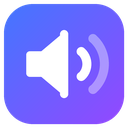

# Hush

Set the volume of each browser tab separately. Works in Chrome, Brave and other Chromium browsers (version 116+).

- Slider from 0% to 200%, with 100% in the middle (snaps to 100% near the centre)
- Mouse wheel over the slider moves it 5% per notch
- Presets: Mute, 25%, 50%, 75%, 100%
- Badge on the toolbar icon shows the current tab's level
- Adjust other tabs you've already set without switching to them
- Remembers your level for each site and turns it down automatically next time

## Install

Hush isn't on the Chrome Web Store, so you load it yourself. It takes about a minute and you don't need any other software.

1. Download `hush.zip` from the [latest release](https://github.com/BentzRL/hush/releases/latest).
2. Right-click the zip and choose **Extract All…**. Put the `hush` folder somewhere permanent, such as `Documents`. Chrome runs the extension from that folder, so don't delete or move it afterwards.
3. In Chrome, type `chrome://extensions` into the address bar and press Enter (in Brave, `brave://extensions`).
4. Turn on **Developer mode** with the switch in the top right.
5. Click **Load unpacked** and choose the `hush` folder (the one that contains `manifest.json`).
6. Click the puzzle-piece icon next to the address bar and pin Hush so it's always visible.

When Chrome starts it may say "Disable developer mode extensions". That's normal for extensions that didn't come from the Web Store; close it and carry on.

**Updating:** download the new `hush.zip`, replace the contents of your `hush` folder, then click the reload arrow on Hush's card at `chrome://extensions`.

## Use

Open the tab you want to change, click the Hush icon and move the slider. Hush remembers the level for that site (for example `youtube.com`), so next time its videos and audio start at that level without a click. **Reset this site to 100%** forgets it.

## How it works

**Live slider:** the extension captures the tab's audio with the `tabCapture` API and plays it back through a Web Audio gain node in an offscreen document. Because of that:

- You start controlling a tab from that tab (Chrome only lets an extension capture a tab you invoked it on).
- Chrome shows its "tab is being shared" indicator on controlled tabs.
- Browser pages (`chrome://`, `brave://`) and the Chrome Web Store can't be captured.

**Remembered levels:** a small script on each page scales the volume of the page's `<video>` and `<audio>` elements, while the site still sees its own volume values, so its own volume control keeps working. Because of that:

- Remembered levels only turn sound down; a saved boost above 100% applies only once you open Hush on the tab.
- Sound a site makes with the Web Audio API (some browser games) isn't turned down automatically; open Hush on the tab to control it live.
- Chrome asks for permission to read and change data on all sites, which the page script needs to run. It only touches media volume.

Saved levels are stored in your browser only. No data leaves your browser; the extension makes no network requests.
